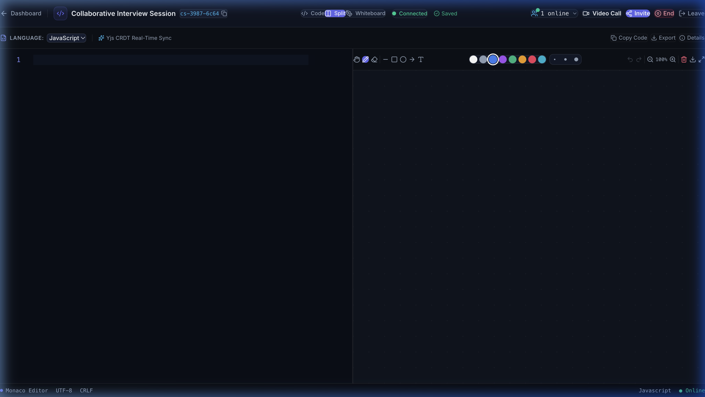
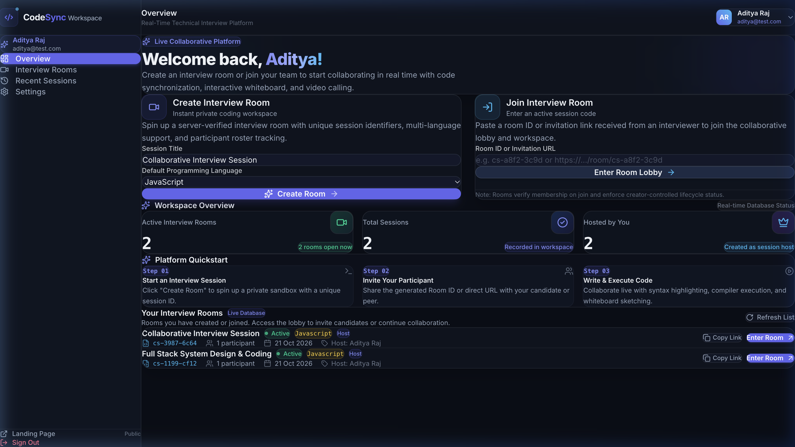
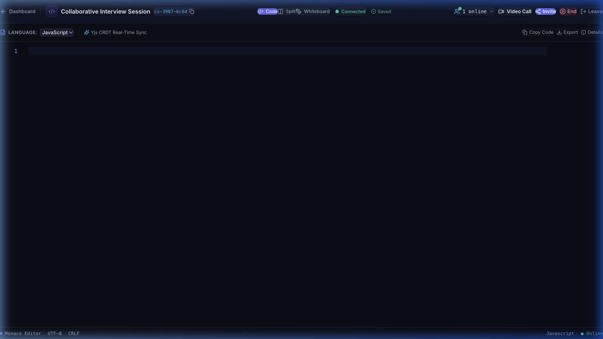
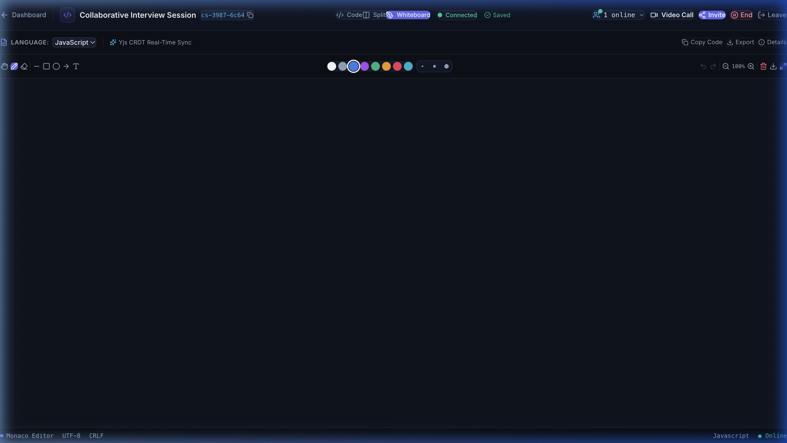
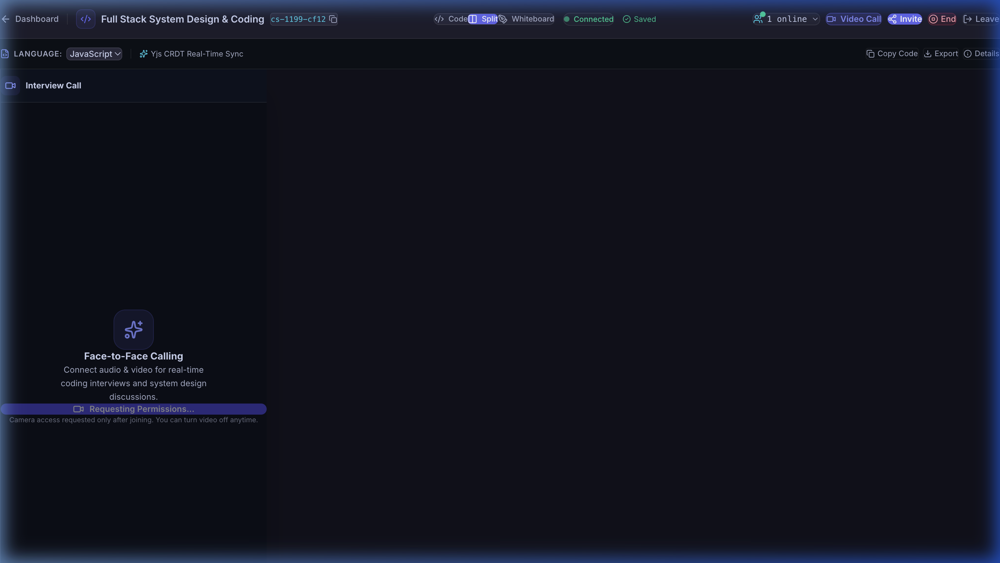
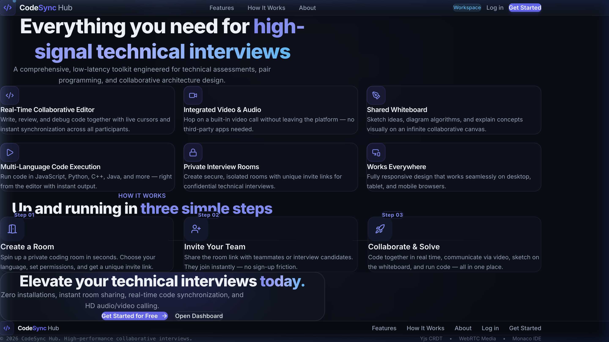
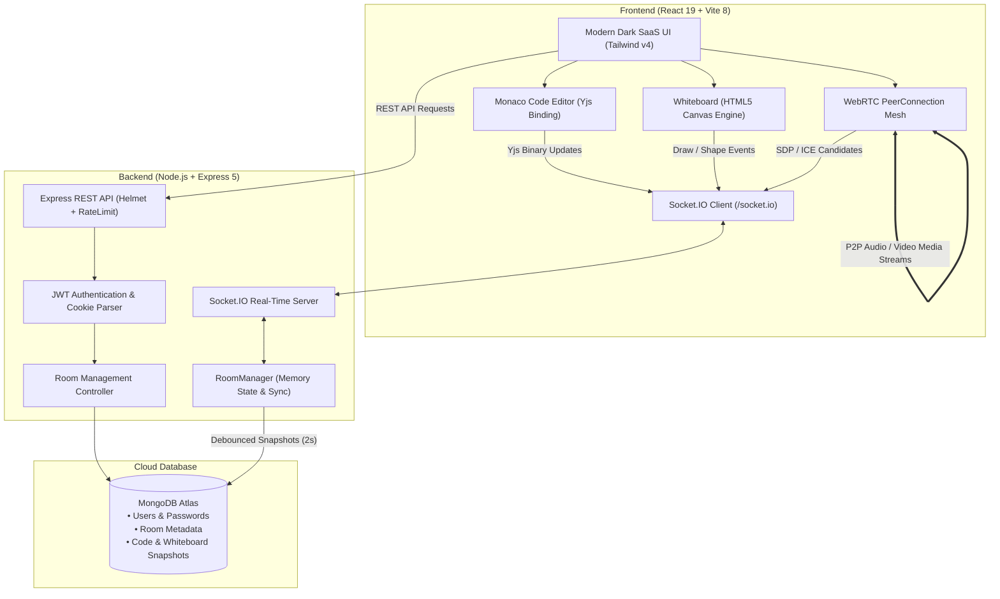

# CodeSync Hub

<div align="center">

# ⚡ CodeSync Hub
### Real-Time Collaborative Coding, System Design Whiteboard & Technical Interview Platform

[](https://react.dev/)
[](https://vitejs.dev/)
[](https://expressjs.com/)
[](https://socket.io/)
[](https://yjs.dev/)
[](https://webrtc.org/)
[](https://microsoft.github.io/monaco-editor/)
[](https://www.mongodb.com/)
[](https://tailwindcss.com/)
[](LICENSE)

<p align="center">
  A state-of-the-art developer platform designed for live technical interviews and pair programming. Featuring conflict-free collaborative code editing, interactive system design whiteboards, mesh WebRTC audio/video calling, and real-time session tracking.
</p>

[Explore Features](#-key-features) • [Screenshots](#-project-showcase) • [Architecture](#-system-architecture) • [Getting Started](#-getting-started-locally) • [API Reference](#-api--socket-reference)

---

</div>

## 📸 Project Showcase

### 1. Collaborative Workspace (Monaco Editor & Interactive Whiteboard Split)
*Split-screen layout pairing the VS Code Monaco editor with an interactive collaborative canvas, live participant roster, and language selector.*


---

### 2. Live Developer Dashboard
*Real-time statistics derived directly from active MongoDB interview rooms, Quick Actions (Instant Room Creation / Room ID Join), and filterable session history.*


---

### 3. Collaborative Monaco Code Editor View
*Full-screen Monaco editor with syntax highlighting, custom dark theme (`codesync-dark`), line counters, multi-language switching, and Yjs CRDT synchronization.*


---

### 4. Real-Time Collaborative System Design Whiteboard
*Dedicated canvas for technical diagrams and architectural schematics featuring freehand drawing, geometric shapes (rectangle, circle, line), eraser, palette selection, and undo.*


---

### 5. Integrated WebRTC Audio & Video Calling
*Peer-to-peer mesh video and audio calling with floating docked video strip, camera/microphone toggle controls, minimize mode, and real-time participant badges.*


---

### 6. Modern SaaS Landing Page
*Engineered with a dark charcoal and slate aesthetic (Linear / Vercel design system), responsive navigation, feature breakdown, and direct onboarding.*


---

## 🚀 Key Features

### 💻 1. Real-Time Collaborative Monaco Code Editor
- **Powered by Monaco Editor:** The same core engine powering Visual Studio Code, with full IntelliSense tokenization, bracket matching, line numbers, and minimap support.
- **Conflict-Free Synchronization with Yjs CRDT:** Implements Yjs Conflict-free Replicated Data Types over WebSockets (`y-monaco` + `y-protocols`), guaranteeing that concurrent keystrokes merge deterministically without race conditions or character drops.
- **Multi-Language Support:** Instant switching between **JavaScript, TypeScript, Python, Java, C++, Go, Rust, Ruby, and PHP** synchronized across all active participants in real time.
- **Debounced Cloud Persistence:** Changes in the Yjs text buffer automatically save to MongoDB Atlas with debounced snapshots, preventing data loss on unexpected disconnections.

### 🎨 2. Real-Time Collaborative Whiteboard
- **60 FPS HTML5 Canvas Engine:** Built for system architecture interviews, database modeling, and whiteboard problem discussions.
- **Shape & Drawing Toolkit:** Freehand drawing pen, straight lines, rectangles, ellipses, and an object-level eraser.
- **Palette & Stroke Controls:** 8 curated developer accent colors and 3 adjustable stroke widths (Thin, Medium, Thick).
- **History & Canvas Actions:** Undo history stack, full canvas clear with confirmation, and late-joining state hydration.

### 📹 3. WebRTC Peer-to-Peer Video & Audio Calling
- **Full Mesh Video Calling:** Direct peer-to-peer WebRTC connections between participants with minimal latency.
- **In-Room Signaling Pipeline:** Socket.IO handles session negotiation (`call:offer`, `call:answer`, `call:ice-candidate`) with room-level cryptographic isolation.
- **Docked Floating Controls:** Bottom floating dock with one-click microphone mute, camera toggle, call termination, and window minimization.
- **Clean Hardware Cleanup:** Hardware tracks (camera and microphone) are cleanly stopped immediately when leaving a call or navigating away.

### 📊 4. Live Developer Dashboard & Room Management
- **Collision-Proof Room IDs:** Secure 8-character human-readable room IDs (`cs-xxxx-xxxx`) generated using `crypto.randomBytes`.
- **Live Database Metrics:** Real-time statistics cards computing Total Sessions, Active Rooms, Hosted Rooms, and Completed Sessions directly from MongoDB.
- **Quick Action Modals:** Create rooms with custom names and target languages in seconds, or join via room ID / clipboard URL invite.
- **Role & Access Controls:** Room creators can end sessions cleanly, locking the room into read-only mode for post-interview review.

### 🛡️ 5. Enterprise Security & Authentication
- **Dual Token Strategy:** JWTs issued in **HTTP-only, secure, `SameSite: Lax` cookies** alongside `Authorization: Bearer <token>` support for cross-environment flexibility.
- **Robust Password Hashing:** Uses `bcryptjs` with 10 salt rounds. Passwords are never stored or leaked.
- **Brute-Force Protection:** Rate limiting configured via `express-rate-limit` on `/api/auth/login` and `/api/auth/register`.
- **Security Headers:** Hardened Express 5 app with `helmet`, strict CORS whitelisting, and defense against user enumeration attacks.

---

## 🏗️ System Architecture



---

## 📁 Repository Directory Structure

```
CodeSync Hub/
├── client/                               # React 19 + Vite frontend
│   ├── src/
│   │   ├── assets/                       # Static branding and icons
│   │   ├── components/                   # Reusable components
│   │   │   ├── auth/                     # AuthLayout, FormInput, ProtectedRoute
│   │   │   ├── dashboard/                # DashboardLayout, QuickActionCards, StatsCards, RecentSessions
│   │   │   ├── video/                    # VideoCallPanel (WebRTC UI, controls, participant tiles)
│   │   │   ├── whiteboard/               # Whiteboard (Canvas, toolbar, color/stroke selectors)
│   │   │   ├── CTA.jsx                   # Bottom call to action banner
│   │   │   ├── Features.jsx              # Feature grid breakdown
│   │   │   ├── Footer.jsx                # Global application footer
│   │   │   ├── Hero.jsx                  # Hero section with interactive preview
│   │   │   ├── HowItWorks.jsx            # 3-step workflow explanation
│   │   │   ├── Navbar.jsx                # Header with auth awareness & user menu
│   │   │   └── ValueStrip.jsx            # Trust & technology badge strip
│   │   ├── context/
│   │   │   └── AuthContext.jsx           # Global authentication state, login, register, logout
│   │   ├── hooks/
│   │   │   ├── useCollaboration.js       # Monaco + Yjs CRDT real-time sync hook
│   │   │   ├── useWebRTC.js              # WebRTC mesh audio/video peer connection hook
│   │   │   └── useWhiteboard.js          # Socket.IO whiteboard drawing synchronization hook
│   │   ├── lib/
│   │   │   ├── api.js                    # Fetch wrapper with credentials and error handling
│   │   │   └── socket.js                 # Shared authenticated Socket.IO instance factory
│   │   ├── pages/
│   │   │   ├── Dashboard.jsx             # User dashboard with stats, rooms, and quick actions
│   │   │   ├── Home.jsx                  # Marketing landing page
│   │   │   ├── Login.jsx                 # Secure login page with validation
│   │   │   ├── Room.jsx                  # Main interview workspace (Editor + Whiteboard + Video)
│   │   │   └── Signup.jsx                # Account registration page
│   │   ├── App.jsx                       # Client router configuration & protected route boundaries
│   │   ├── index.css                     # Design system tokens, Inter & JetBrains Mono fonts, resets
│   │   └── main.jsx                      # React 19 DOM root
│   ├── index.html                        # Application entry point & meta tags
│   ├── package.json                      # Client dependencies & scripts
│   └── vite.config.js                    # Vite config with Tailwind v4 & /api proxy to :5001
├── server/                               # Node.js + Express 5 API server
│   ├── src/
│   │   ├── config/
│   │   │   └── db.js                     # Mongoose connection with reconnection logic
│   │   ├── controllers/
│   │   │   ├── authController.js         # Register, login, getMe, logout handlers
│   │   │   └── roomController.js         # Room create, join, get, end, and metrics handlers
│   │   ├── middleware/
│   │   │   ├── authMiddleware.js         # JWT verification (cookie + Authorization header)
│   │   │   ├── errorMiddleware.js        # Global error boundary & formatted JSON responses
│   │   │   └── rateLimitMiddleware.js    # Rate limiting for auth endpoints
│   │   ├── models/
│   │   │   ├── Room.js                   # Room schema with debounced code & whiteboard storage
│   │   │   └── User.js                   # User schema with bcrypt password hashing
│   │   ├── routes/
│   │   │   ├── authRoutes.js             # /api/auth routes
│   │   │   └── roomRoutes.js             # /api/rooms routes
│   │   ├── socket/
│   │   │   ├── index.js                  # Socket.IO server initialization & event dispatching
│   │   │   └── roomManager.js            # In-memory Yjs sync, whiteboard state, and DB persistence
│   │   ├── app.js                        # Express app config (Helmet, CORS, cookie parser, JSON)
│   │   ├── index.js                      # Server startup entrypoint
│   │   └── server.js                     # HTTP server wrapper
│   ├── test/                             # 53 Automated Integration Test Suites
│   │   ├── verifyAuth.js                 # 12 Authentication & Security tests
│   │   ├── verifyCollaboration.test.js   # 8 Real-Time Yjs Code Collaboration tests
│   │   ├── verifyRooms.test.js           # 11 Room Management & Access Control tests
│   │   ├── verifyVideoSignaling.test.js  # 11 WebRTC Audio/Video Signaling tests
│   │   └── verifyWhiteboard.test.js      # 11 Real-Time Collaborative Whiteboard tests
│   └── package.json                      # Server dependencies & test scripts
├── docs/
│   └── screenshots/                      # Presentation screenshots for GitHub & demos
├── .gitignore
└── README.md
```

---

## 🛠️ Tech Stack & Dependencies

### Frontend (`client/`)
| Category | Technology | Version | Description |
| :--- | :--- | :--- | :--- |
| **Framework** | [React](https://react.dev/) | `^19.3.1` | Modern component-driven UI library |
| **Build Tool** | [Vite](https://vitejs.dev/) | `^8.3.4` | Ultra-fast development server & bundler |
| **Styling** | [Tailwind CSS](https://tailwindcss.com/) | `^4.3.3` | Utility-first CSS engine with `@tailwindcss/vite` |
| **Code Editor** | [Monaco Editor](https://microsoft.github.io/monaco-editor/) | `^0.57.0` | Industrial code editor engine from VS Code |
| **Editor React** | [@monaco-editor/react](https://github.com/suren-atoyan/monaco-react) | `^4.7.0` | Monaco Editor wrapper for React |
| **CRDT Engine** | [Yjs](https://yjs.dev/) | `^13.6.33` | High-performance CRDT framework for shared types |
| **Monaco Binding** | [y-monaco](https://github.com/yjs/y-monaco) | `^0.1.6` | Two-way binding between Yjs text and Monaco models |
| **Real-Time Client**| [socket.io-client](https://socket.io/) | `^4.8.4` | WebSocket and long-polling transport client |
| **Routing** | [react-router-dom](https://reactrouter.com/) | `^7.18.4` | Declarative client-side routing |
| **Icons** | [lucide-react](https://lucide.dev/) | `^1.61.0` | Crisp, scalable icon library |
| **Linter** | [oxlint](https://oxc.rs/) | `^1.88.0` | Next-generation ultra-fast JavaScript/React linter |

### Backend (`server/`)
| Category | Technology | Version | Description |
| :--- | :--- | :--- | :--- |
| **Runtime** | [Node.js](https://nodejs.org/) | `>=18.0.0` | JavaScript server runtime |
| **Framework** | [Express](https://expressjs.com/) | `^5.1.0` | Minimalist and fast web application framework |
| **Real-Time** | [Socket.IO](https://socket.io/) | `^4.8.4` | Bi-directional event-based communication server |
| **Database** | [MongoDB Atlas](https://www.mongodb.com/) + [Mongoose](https://mongoosejs.com/) | `^9.11.2` | Elegant MongoDB object modeling for Node.js |
| **CRDT Server** | [Yjs](https://yjs.dev/) | `^13.6.33` | Server-side CRDT document hydration and diff merge |
| **Authentication** | [jsonwebtoken](https://github.com/auth0/node-jsonwebtoken) | `^9.0.3` | Cryptographic JWT signing and verification |
| **Security** | [bcryptjs](https://github.com/dcodeIO/bcrypt.js) | `^3.0.3` | Salted password hashing (10 rounds) |
| **App Security** | [helmet](https://helmetjs.github.io/) | `^8.3.0` | Secure HTTP response headers |
| **Rate Limiting** | [express-rate-limit](https://github.com/express-rate-limit/express-rate-limit) | `^8.7.1` | DOS and brute-force mitigation |
| **CORS** | [cors](https://github.com/expressjs/cors) | `^2.8.5` | Cross-Origin Resource Sharing middleware |
| **Cookies** | [cookie-parser](https://github.com/expressjs/cookie-parser) | `^1.4.7` | Parse HTTP cookie headers |
| **Testing** | [mongodb-memory-server](https://github.com/nodkz/mongodb-memory-server) | `^11.3.0` | Ephemeral in-memory MongoDB for zero-config CI tests |

---

## 🚦 Getting Started Locally

### Prerequisites
- **Node.js:** v18.0.0 or higher
- **npm:** v9.0.0 or higher
- **MongoDB:** MongoDB Atlas cloud cluster (recommended) or local MongoDB instance

---

### 1. Backend Setup

```bash
cd "CodeSync Hub/server"

# Create .env from template
cp .env.example .env

# Edit .env with your credentials:
# PORT=5001
# MONGODB_URI=mongodb+srv://<username>:<password>@cluster0.xxxxx.mongodb.net/codesync-hub?retryWrites=true&w=majority
# JWT_SECRET=your_super_secret_jwt_key_here
# CLIENT_ORIGIN=http://localhost:5173

# Install dependencies
npm install

# Run all 53 automated tests across Auth, Rooms, Yjs, Whiteboard, and Video Signaling
npm test

# Start the backend development server
npm run dev
```

The API & WebSocket server will boot on **http://localhost:5001**.  
Health check endpoint:
```bash
curl http://localhost:5001/api/health
```

---

### 2. Frontend Setup

In a separate terminal:

```bash
cd "CodeSync Hub/client"

# Create .env from template (optional, defaults to relative /api proxy)
cp .env.example .env

# Install dependencies
npm install

# Run the linter
npm run lint

# Start the Vite development server
npm run dev
```

Open **http://localhost:5173** in your web browser. Requests sent to `/api/*` and WebSocket connections to `/socket.io` are automatically proxied to the backend on `:5001`.

---

## 🧪 Comprehensive Test Suites

The backend includes **53 automated integration tests** that run against an in-memory MongoDB server without requiring external database connections:

```bash
cd server
npm test
```

| Test Suite | File | Tests | Coverage |
| :--- | :--- | :---: | :--- |
| **Authentication** | `test/verifyAuth.js` | **12** | Registration, bcrypt hashing, JWT cookie/header validation, rate-limiting, user enumeration defense. |
| **Room Management** | `test/verifyRooms.test.js` | **11** | Room creation, ID collisions, language assignment, participant join, creator privileges, read-only ended rooms. |
| **Code Collaboration** | `test/verifyCollaboration.test.js` | **8** | Socket.IO auth, initial Yjs hydration, concurrent editing, language sync, debounced DB persistence, presence. |
| **Whiteboard Engine** | `test/verifyWhiteboard.test.js` | **11** | Freehand strokes, geometric shapes, eraser, room isolation, tombstone resurrection defense, snapshot persistence. |
| **WebRTC Video Signaling** | `test/verifyVideoSignaling.test.js` | **11** | Peer discovery, SDP Offer/Answer relay, ICE candidate exchange, mute/video sync, payload size guards (>64KB). |
| **Total** | | **53/53 Passed** | **100% Core Functionality Verified** |

Individual suites can also be run selectively:
```bash
npm run test:auth
npm run test:rooms
npm run test:collab
npm run test:whiteboard
npm run test:video
```

---

## 📡 API & Socket Reference

### REST Endpoints

| Method | Endpoint | Description | Auth Required |
| :--- | :--- | :--- | :---: |
| `GET` | `/api/health` | Service health and database connection status | No |
| `POST` | `/api/auth/register` | Register a new user account | No |
| `POST` | `/api/auth/login` | Authenticate with email/password; returns JWT | No |
| `GET` | `/api/auth/me` | Fetch currently authenticated user profile | **Yes** |
| `POST` | `/api/auth/logout` | Clear session and HTTP-only auth cookie | **Yes** |
| `POST` | `/api/rooms` | Create a new interview room with custom language | **Yes** |
| `GET` | `/api/rooms` | List rooms where the user is a creator or participant | **Yes** |
| `GET` | `/api/rooms/metrics` | Retrieve live system-wide interview statistics | **Yes** |
| `GET` | `/api/rooms/:roomId` | Retrieve metadata, participant list, and code snapshot | **Yes** |
| `POST` | `/api/rooms/:roomId/join` | Join an active room as a participant | **Yes** |
| `PATCH` | `/api/rooms/:roomId/end` | End an interview room (Creator only) | **Yes** |

### Real-Time Socket.IO Events

| Namespace / Event | Direction | Payload | Description |
| :--- | :--- | :--- | :--- |
| `room:join` | Client ➔ Server | `{ roomId }` | Authenticated client joins room workspace |
| `room:ready` | Server ➔ Client | `{ roomId, language, participants }` | Confirms room entry and passes active state |
| `yjs:initial-state` | Server ➔ Client | `Uint8Array` (Binary) | Initial binary snapshot of the Yjs code document |
| `yjs:update` | Bi-directional | `Uint8Array` (Binary) | Incremental CRDT update for synchronized typing |
| `room:language` | Bi-directional | `{ language }` | Synchronizes active programming language across all clients |
| `whiteboard:stroke` | Bi-directional | `{ stroke }` | Relays freehand pen vectors and geometric shape coordinates |
| `whiteboard:clear` | Bi-directional | `{}` | Clears whiteboard canvas for all participants in the room |
| `call:join` | Client ➔ Server | `{ roomId }` | Participant joins WebRTC video/audio call session |
| `call:peer-joined` | Server ➔ Client | `{ peerId, user }` | Notifies active call participants of a new peer |
| `call:offer` | Bi-directional | `{ to, offer }` | Relays WebRTC SDP Offer to target peer |
| `call:answer` | Bi-directional | `{ to, answer }` | Relays WebRTC SDP Answer to target peer |
| `call:ice-candidate` | Bi-directional | `{ to, candidate }` | Relays ICE candidate for NAT traversal / STUN connection |
| `call:media-state` | Bi-directional | `{ isMuted, isVideoOff }` | Synchronizes microphone and camera status badges |
| `call:leave` | Bi-directional | `{}` | Cleanly leaves call and disconnects WebRTC peer streams |

---

## 📜 License

This project is licensed under the [MIT License](LICENSE).

---

<div align="center">
  <b>Built with ❤️ by Aditya Raj & the CodeSync Hub Team</b><br/>
  <i>Engineered for next-generation developer collaboration and remote technical interviews.</i>
</div>
